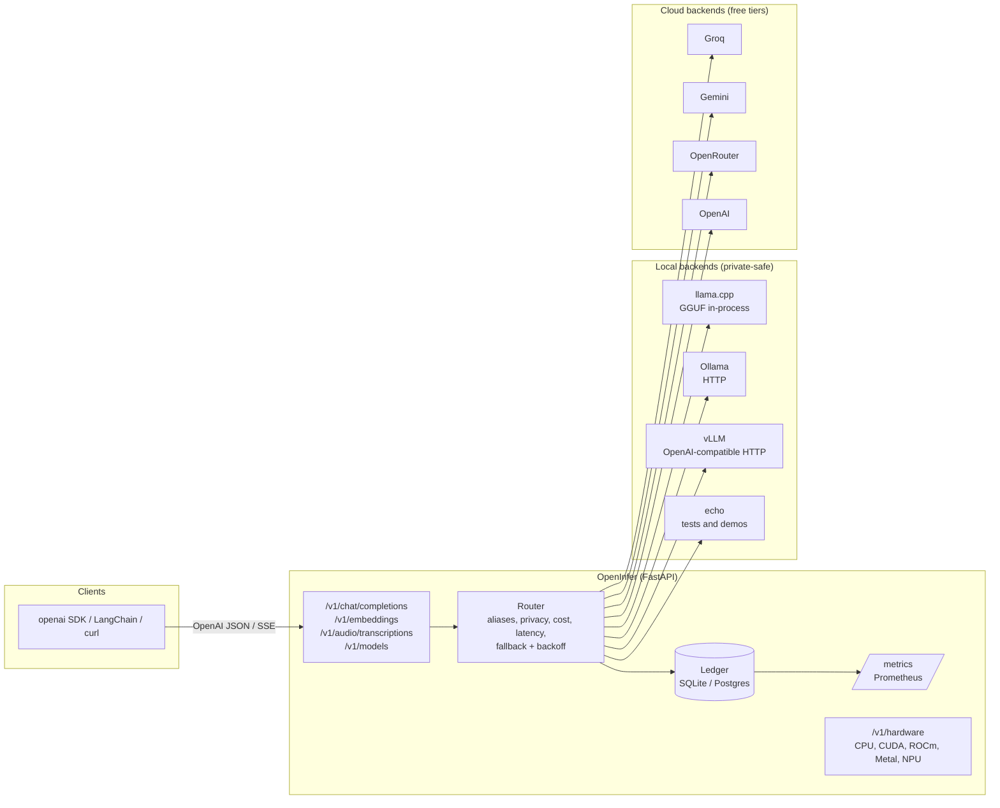
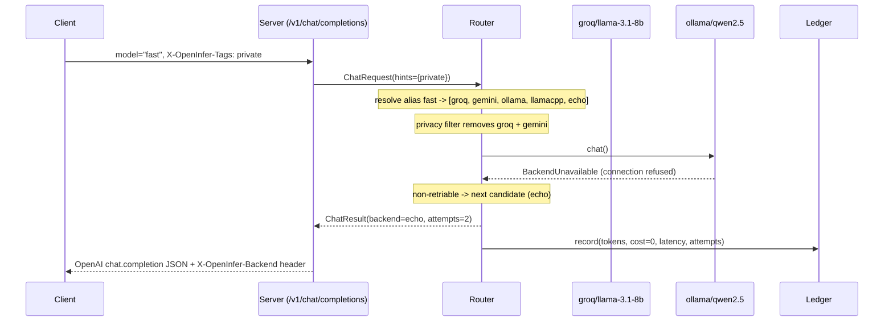

# OpenInfer

**One model, any hardware.** An OpenAI-compatible inference runtime that runs the same model on
CPU, Apple Metal, NVIDIA CUDA, AMD ROCm or Intel/Qualcomm NPU, and routes each request local or
cloud by **privacy, latency and cost**. Breaks CUDA lock-in; keeps private data on your own machine.

[](https://github.com/Hassan-Memon/openinfer/actions/workflows/ci.yml)


```bash
uvx openinfer serve          # http://localhost:8000/docs  (zero keys needed)
```

```python
from openai import OpenAI
client = OpenAI(base_url="http://localhost:8000/v1", api_key="unused")
client.chat.completions.create(model="fast", messages=[{"role": "user", "content": "hi"}])
```

Point any OpenAI SDK, LangChain `ChatOpenAI(base_url=...)`, or `curl` at it. Ask for `fast`,
`smart`, `private` or `embed` instead of a vendor model name and let the policy decide.

## Why

| Problem | What OpenInfer does |
|---|---|
| Every inference stack assumes one vendor's GPU | One GGUF file runs through llama.cpp on CPU, Metal, CUDA, ROCm; Ollama and vLLM plug in over HTTP; cloud is one more backend |
| Private data must not leave the building, but the cloud model is better for everything else | Tag a request `private` and only local backends are eligible. If none is up the request fails closed (HTTP 422), it never falls through to the cloud |
| Nobody knows what inference costs until the invoice | Every request writes tokens, cost, latency and time to first token to a ledger; `/v1/ledger`, `/metrics` and `openinfer bench` read it back |
| Switching providers means rewriting clients | The API is OpenAI's. Clients keep their SDK; only the base URL changes |
| Free tiers and rate limits make single-provider setups flaky | Alias chains with retries and exponential backoff fall through Groq, Gemini, OpenRouter, Ollama, llama.cpp, in the order you choose |

## Architecture



A request's path, end to end:



Code map: `openinfer/server` (routes and OpenAI shapes), `openinfer/router` (policy engine),
`openinfer/backends` (adapters), `openinfer/hardware` (detection), `openinfer/ledger`,
`openinfer/bench`, `openinfer/cli.py`. Start with
[docs/learn/01-architecture-walkthrough.md](docs/learn/01-architecture-walkthrough.md).

## Quickstart

### Zero install

```bash
uvx openinfer serve                      # uv runs it from PyPI into a cached env
curl localhost:8000/v1/chat/completions -H 'content-type: application/json' \
  -d '{"model":"fast","messages":[{"role":"user","content":"ping"}]}'
```

With no API keys and no Ollama, `fast` resolves to the deterministic `echo` backend. The whole
API still works, which is what the tests, CI and the Hugging Face demo use.

### From source

```bash
git clone https://github.com/Hassan-Memon/openinfer && cd openinfer
uv sync                                   # Python 3.12+, installs dev tools too
cp .env.example .env                      # optional: add GROQ_API_KEY etc.
uv run openinfer serve
uv run pytest                             # 100+ tests, all offline
```

### Docker

```bash
docker compose up                         # echo backend, port 8000
docker compose --profile ollama up        # also start Ollama in the stack
docker compose exec ollama ollama pull qwen2.5:0.5b
```

### A real local model on CPU (llama.cpp)

```bash
uv sync --extra llamacpp                  # builds llama.cpp for your CPU (or set CMAKE_ARGS for Metal/CUDA/ROCm)
uv run openinfer download-model           # Qwen2.5-0.5B-Instruct Q4_K_M, about 400 MB
# openinfer.yaml: backends.llamacpp.enabled: true
uv run openinfer serve
curl localhost:8000/v1/chat/completions -d '{"model":"private","messages":[{"role":"user","content":"hello"}]}' -H 'content-type: application/json'
```

`openinfer hardware` prints the detected accelerator and the exact `CMAKE_ARGS` to build for it.
Note: on Windows, `llama-cpp-python` compiles from source and needs Visual Studio Build Tools;
Ollama is the easier local path there.

## Routing in one screen

`openinfer.yaml` (the one in this repo is the packaged default):

```yaml
aliases:
  fast:    [groq/llama-3.1-8b-instant, gemini/gemini-2.0-flash-lite, ollama/qwen2.5:0.5b, echo/echo]
  smart:   [groq/llama-3.3-70b-versatile, openrouter/meta-llama/llama-3.3-70b-instruct:free, echo/echo]
  private: [llamacpp/qwen2.5-0.5b-instruct, ollama/qwen2.5:0.5b, echo/echo]
  embed:   [ollama/nomic-embed-text, gemini/text-embedding-004, echo/echo-embed]
policy:
  private_tag: private        # tag => local backends only, fail closed
  max_cost_usd: null          # global ceiling per request (estimated before sending)
  max_latency_ms: null        # drops candidates whose measured p50 is slower
  retries: 2                  # per backend on 429 / 5xx / timeout, exponential backoff
```

Per request hints, any of:

```http
X-OpenInfer-Tags: private
X-OpenInfer-Max-Cost-USD: 0.001
X-OpenInfer-Max-Latency-Ms: 800
```

```json
{"model": "fast", "messages": [...], "openinfer": {"tags": ["private"], "max_cost_usd": 0.001}}
{"model": "fast", "messages": [...], "metadata": {"privacy": "private"}}
```

Model names also accept `backend/model` (`ollama/llama3.1:8b`) or a bare model listed by a
backend. Responses carry `openinfer: {backend, model, alias, cost_usd, latency_ms, attempts}`
and `X-OpenInfer-*` headers so you can see what actually served you.

## API

| Route | Notes |
|---|---|
| `POST /v1/chat/completions` | OpenAI shape, `stream: true` gives SSE with `[DONE]`, `stream_options.include_usage` supported, tools pass through, `reasoning_content` for thinking models |
| `POST /v1/embeddings` | `float` or `base64`, `dimensions` honoured where the backend can |
| `POST /v1/audio/transcriptions` | faster-whisper, `uv sync --extra whisper`; 501 otherwise |
| `GET /v1/models` | aliases plus `backend/model` cards, with `openinfer.local` flag |
| `GET /health` | per backend probe, `?deep=false` for a cheap liveness check |
| `GET /v1/hardware` | CPU features, CUDA/ROCm/Metal/NPU, recommended build |
| `GET /v1/ledger?hours=24` | spend, tokens, p50/p95 latency, by backend |
| `GET /metrics` | Prometheus, `uv sync --extra metrics` |

Set `OPENINFER_API_KEY` to require a bearer token on `/v1/*`.

## CLI

```bash
openinfer serve [--host --port --config --reload]
openinfer bench [--backend echo --backend ollama] [--runs 3] [--max-tokens 128] [--json]
openinfer hardware [--json]
openinfer models [--json]
openinfer config
openinfer download-model [--repo Qwen/Qwen2.5-0.5B-Instruct-GGUF] [--file ...]
```

`bench` output (this laptop, CPU only, Ollama running):

| Backend | Model | Where | TTFT p50 (ms) | Gen tokens/s | Total p50 (ms) | $/1M out tokens | Status |
|---|---|---|---:|---:|---:|---:|---|
| echo | echo | local | 0.1 | 171,059.0 | 0.2 | 0.00 | ok |
| ollama | deepseek-r1:1.5b | local | 380.3 | 16.0 | 3,376.1 | 0.00 | ok |

## Deploy for free

- [Hugging Face Spaces (Docker, CPU)](docs/deploy/huggingface-spaces.md): public demo on echo or a 0.5B GGUF
- [Render free web service](docs/deploy/render.md): Docker, sleeps when idle
- [Oracle Cloud Always Free ARM](docs/deploy/oracle-always-free.md): 4 OCPU / 24 GB, llama.cpp with NEON, the best free "real model" option
- [AWS EC2 cost model](docs/aws-cost-model.md): what it would cost if you did pay (documented, not required)

## Documentation

- `docs/learn/` teaching track: [architecture walkthrough](docs/learn/01-architecture-walkthrough.md), [system design trade-offs](docs/learn/02-system-design-tradeoffs.md), [concepts](docs/learn/03-concepts/), [interview talk track](docs/learn/04-interview-talk-track.md), [run it yourself](docs/learn/05-run-it-yourself.md)
- `docs/adr/` decision records: [OpenAI-compatible API](docs/adr/0001-openai-compatible-api.md), [policy as YAML](docs/adr/0002-router-policy-as-yaml.md), [llama.cpp first](docs/adr/0003-llamacpp-first.md), [SQLite ledger](docs/adr/0004-sqlite-ledger.md), [privacy routing](docs/adr/0005-privacy-routing-fail-closed.md), [echo backend](docs/adr/0006-echo-backend-for-tests-and-demos.md)
- [docs/positioning.md](docs/positioning.md): who this is for and how it compares to NVIDIA NIM, Apple on-device, the OpenAI API, Ollama, LiteLLM and vLLM
- [CONTRIBUTING.md](CONTRIBUTING.md), [SECURITY.md](SECURITY.md)

## Status

Pre-1.0. The echo, Ollama, vLLM and cloud paths are tested; the Ollama path was also verified
against a real local model. llama.cpp and faster-whisper are optional extras and exercised
manually. See [docs/learn/02-system-design-tradeoffs.md](docs/learn/02-system-design-tradeoffs.md)
for what breaks first at scale.

## License

Apache-2.0. Copyright 2026 Hassan Memon.
